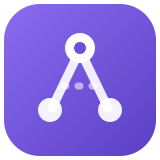

<p align="center">
  
</p>

<h1 align="center">AgentFlow</h1>

<p align="center">
  <strong>A self-organizing AI team you run on your own machine.</strong><br>
  Give one goal in chat. A lead agent builds the team, plans, delegates, reviews and delivers,
  using the Codex, Claude Code and Gemini CLIs you are already signed in to.
</p>

<p align="center">
  
  
  
  
  
</p>

---

## Contents

- [Why AgentFlow](#why-agentflow)
- [Features](#features)
- [Requirements](#requirements)
- [Quick start](#quick-start)
- [Authorize the model providers](#authorize-the-model-providers)
- [Configuration](#configuration)
- [Telegram control](#telegram-control)
- [Everyday use](#everyday-use)
- [Operations](#operations)
- [Security and privacy](#security-and-privacy)
- [Architecture](#architecture)
- [Development](#development)
- [Limitations](#limitations)
- [Open-source checklist: what stays local](#open-source-checklist-what-stays-local)
- [License](#license)

## Why AgentFlow

- **Uses the subscriptions you already have.** Inference runs through the official Codex, Claude Code and Gemini CLIs on your
  machine. AgentFlow reuses their sign-in and never copies or stores provider tokens.
- **A team, not a chatbot.** A lead agent (Atlas by default) creates teammates, assigns tasks with dependencies, runs independent
  reviews with scores and revisions, and asks you only the decisions that are really yours.
- **Built to save tokens.** Native session resume, a stable cached system prefix, deferred tool schemas, automatic compaction,
  clipped tool output and adaptive reasoning effort keep long tasks affordable.
- **Keeps working when limits hit.** Per-provider quota episodes park work and resume at reset, or switch to a fallback model you
  approved, then switch back.
- **You stay in control.** Folder grants (read or read-write), website grants, command approvals, budgets, model autonomy levels
  and a Stop-all button. Every change to the team's default model is logged with who and why.
- **Zero install for the core.** Python standard library only. Optional extras (browser automation, PDF parsing, SSH) install on
  demand into the local data folder.
- **Local first.** One process bound to `127.0.0.1`. Data, conversations and files stay on your disk.

## Features

**Team and coordination**
- Durable agents with their own inbox, memory, skills, tools and model; agents can create, re-role and archive teammates.
- Tasks with dependencies, automatic dispatch, independent review (approve / revise with a 1–5 score) and revision loops.
- Multiple goals per project; agents keep the goal current and you remove finished ones.
- Wait-cycle detection: if agents end up waiting on each other, the runtime resumes the right one, and after three loops it asks you.
- Customizable team heartbeat (interval, active hours and days) with a no-model status digest.

**Chat that shows only what matters**
- Agent narration and auto-approved actions fold into a collapsed work log; each row expands to the exact command and folder.
- Questions arrive as compact decision cards with buttons; answered questions collapse to one line and expand on click.
- Rich replies: tables, code, charts, image galleries with a lightbox, interactive canvases, file cards.
- Live status: "last activity 30s ago", "thinking for 2 min", and an amber "stuck" hint with a Resume button.

**Work panel and file preview**
- Right bar per project: goals, progress checklist, budget and tokens, folders and grants, outputs.
- Outputs split into **For you** (deliverables the agents chose for you) and **Changed files** (real diffs).
- A separate, resizable preview pane with tabs: rendered Markdown, canvas, images, PDF, source, diff. Edit and save text files
  (with conflict detection), open in the native app, or download.

**Models and providers**
- Codex CLI, Claude Code CLI, Gemini CLI and any OpenAI-compatible gateway. Model catalogs come from the providers themselves.
- Team default model, per-chat overrides, per-agent pins and per-phase policies (for example Opus for planning, Sonnet for coding).
- Model autonomy setting: **Locked**, **Phases only** (default) or **Full**, plus a change log of every default-model change.
- Usage strip with 5-hour and weekly windows, plan badge, last-updated time and quiet back-off when a usage endpoint rate-limits.

**Tools for agents**
- Project files (read, search, write, diff, trash with restore), sandboxed commands, web fetch and research.
- Managed Chromium browser with semantic controls, screenshots, per-site grants and a local host map for dev domains.
- Skills: install from catalogs or GitHub `SKILL.md`, or let agents write and version their own.
- Custom tools (`/create-tool`), MCP servers (stdio and Streamable HTTP) with approvals.
- Image generation through the agent's own provider (Codex built-in image generation, Gemini API) or a fixed engine, with an
  Image Studio (aspect ratio, size, quality, style presets, references).

**Channels and automation**
- Telegram bot over long polling (no public server needed): group or private chat, routing to any member, decision buttons,
  file delivery, `/status`, typed `/set` configuration and `/restart`.
- Facebook Page drafts and scheduling, Messenger support replies and an authenticated SEO webhook (optional).
- Scheduled routines, budgets per run and per project, and automatic disk housekeeping that asks before deleting anything large.

## Requirements

| Component | Needed for | Notes |
| --- | --- | --- |
| Python **3.12+** | the runtime | Standard library only. On Windows the start script also finds `py -3.12` and pyenv-win installs. |
| At least one model CLI | inference | [Codex CLI](https://developers.openai.com/codex/cli), [Claude Code](https://docs.claude.com/en/docs/claude-code/overview) or [Gemini CLI](https://github.com/google-gemini/gemini-cli). Each needs its own account. |
| Node.js (LTS) | installing the CLIs via npm | Not used by AgentFlow itself. |
| A modern browser | the web UI | Served from `http://127.0.0.1:8765`. |
| Optional: pip + network | browser automation, PDF parsing, SSH plugin | Installed on demand into `.agentflow/` the first time an agent needs them. |

Windows is the primary platform (start/stop/restart scripts, DPAPI-encrypted secrets, command sandbox). The runtime also runs on
macOS and Linux with `python server.py`; secrets are then stored in an owner-only file.

## Quick start

```bash
git clone <your-fork-url> agentflow
cd agentflow
python server.py            # any OS; open http://127.0.0.1:8765
```

On Windows you can instead run:

```powershell
.\Start-AgentFlow.ps1       # finds Python, starts hidden, opens the browser
```

Then:

1. Sign in to at least one provider CLI (next section).
2. Open **Connections & models**. Your CLIs, signed-in accounts and model catalogs appear there.
3. Enable **Local AI execution** on the same page. A new workspace starts paused, so nothing runs until you say so.
4. Open the chat with **Atlas** and pick the team default model with the model button next to Send.
5. Describe a goal, for example: *"Build a small team to prepare our product launch. Split the work, create the skills you need and
   ask me the decisions you can't make."*

The first start creates two local folders next to the code: `.agentflow/` (database, vault, logs) and `workspaces/company/`
(files the agents produce). Both are ignored by git.

## Authorize the model providers

AgentFlow never asks for your provider password and never copies tokens. It runs the vendor CLI as you, on the same Windows user
profile, so **whatever account the CLI is signed in to is the account AgentFlow uses**. Sign in once in a normal terminal, then
refresh **Connections & models**.

Vendor install commands change over time; if one below fails, use the linked official instructions.

### Codex CLI (OpenAI)

1. Install: `npm install -g @openai/codex` (see the [Codex CLI docs](https://developers.openai.com/codex/cli)).
2. Sign in: run `codex` (or `codex login`) and choose **Sign in with ChatGPT**. A ChatGPT plan that includes Codex is required;
   API-key sign-in also works but is billed per token.
3. Check: `codex --version` works in a new terminal.

What AgentFlow uses: `codex exec` for agent turns (with session resume), and the local `codex app-server` for the model list and
your plan's rate-limit windows. Image generation uses Codex's built-in image tool and counts toward your Codex plan.

### Claude Code (Anthropic)

1. Install Claude Code by following the [official setup guide](https://docs.claude.com/en/docs/claude-code/setup)
   (native installer, or `npm install -g @anthropic-ai/claude-code`). The VS Code extension's bundled CLI is also detected.
2. Sign in: run `claude`, then `/login`, and choose your Claude subscription (Pro, Max, Team or Enterprise) or an Anthropic
   Console account.
3. Check: `claude auth status` reports your account.

What AgentFlow uses: `claude -p` with `--session-id` / `--resume` for agent turns, `claude auth status --json` for the account, the
SDK initialize handshake for the model catalog, and the CLI's own OAuth session only to read your subscription usage windows
(the token is read from the CLI's credential file at request time and is never stored or displayed). Claude Desktop sign-in is
separate and is not used.

### Gemini CLI (Google)

1. Install: `npm install -g @google/gemini-cli` (see the [Gemini CLI repository](https://github.com/google-gemini/gemini-cli)).
   You can also click **Sign in** on the Gemini card in **Connections & models**, which opens a console running `gemini`.
2. Sign in: run `gemini` and choose **Login with Google**, or set `GEMINI_API_KEY`, or use Vertex AI
   (`GOOGLE_API_KEY` with `GOOGLE_GENAI_USE_VERTEXAI=true`).
3. Images: Google sign-in covers chat only. To generate images with Gemini models, save a **Gemini API key** in the Gemini card
   (stored in the local vault).

### OpenAI-compatible gateway (optional)

Set the gateway URL in **Connections & models** and the key as `GATEWAY_API_KEY` (in the UI or `.env`). Models come from the
gateway's `/v1/models`; images use `/images/generations`.

### CLIs that are not on PATH

Copy `.env.example` to `.env` and point to the executables:

```ini
CODEX_PATH=C:\path\to\codex.exe
CLAUDE_PATH=C:\path\to\claude.exe
GEMINI_PATH=C:\path\to\gemini.cmd
```

### Switching accounts

Sign out and in with the vendor CLI. AgentFlow detects the new identity on the next check, drops the old account's catalog and
usage, and continues unfinished work from its checkpoint. If the new account lacks the selected model, the run waits until you
pick one.

## Configuration

Everything is configurable in the web UI; secrets can also come from `.env`.

| Where | What |
| --- | --- |
| **Connections & models** | Provider status and accounts, model catalogs, Local AI execution switch, gateway, Gemini key, Telegram, Facebook/Messenger/SEO, image engine. |
| **Settings › Team default model** | Default provider/model/reasoning, **Model autonomy** (Locked · Phases only · Full), agents that diverged from the default, recent model changes. |
| **Settings › Budget** | Turns per run, turns and runs per project, token budget per project. A halted goal offers *Continue*, *Allow for this task* or *Cancel*. |
| **Settings › When a provider runs out of usage** | Ask me, wait for reset, or switch to fallback models (ordered list) automatically. |
| **Chat composer** | Approval mode (*Ask for approval* / *Always approve for me*) for commands and websites; folder access and credentials always ask. |
| **Work cadence** | Team heartbeat (interval, active hours and days, pulse digest) and scheduled routines. |
| **Settings › Storage** | Disk usage, trash and automatic cleanup of caches and old artifacts; asks before freeing space that holds real work. |
| **Settings › Restart runtime** | Restarts the local runtime (also `Restart-AgentFlow.cmd` and Telegram `/restart`). |

`.env` keys (all optional; see `.env.example`): `CODEX_PATH`, `CLAUDE_PATH`, `GEMINI_PATH`, `GATEWAY_API_KEY`, `TELEGRAM_BOT_TOKEN`,
`TELEGRAM_WEBHOOK_SECRET`, `FACEBOOK_PAGE_TOKEN`, `FACEBOOK_APP_SECRET`, `META_VERIFY_TOKEN`, `SEO_WEBHOOK_SECRET`,
`PUBLIC_WEBHOOK_HOST`. Values saved in the UI go to the local vault (DPAPI-encrypted on Windows) and are never sent back to the
browser.

## Telegram control

1. Create a bot with [@BotFather](https://t.me/BotFather) and copy its token.
2. In @BotFather: **Bot Settings › Group Privacy › Turn off** (or make the bot a group admin) so it can read plain group messages.
   If the bot was already in the group, remove and re-add it.
3. Paste the token in **Connections & models › Telegram** and save. The bot connects immediately over long polling; no public URL,
   webhook or restart is needed.
4. Send any message to the bot (private chat or a group with the bot). AgentFlow asks you in the web chat whether to link that chat;
   press **Link**. Only the person who linked it (plus owners you add in Settings) can control the team; other members are ignored.

What you get: plain messages go to the default agent (`@Name` or `Name:` routes to another member, replying to a bot message
answers that agent), every question arrives once with buttons, deliverables arrive as files, and these commands:

| Command | Action |
| --- | --- |
| `/status` | Each member's state, current task, model, last activity, plus quota windows |
| `/agents`, `/files [n]` | Team roster; latest deliverables with buttons to send them |
| `/goal <text>` | Add a goal |
| `/stop [name\|all]` | Stop work (asks to confirm) |
| `/approve ask\|auto` | Approval mode for this chat |
| `/showall`, `/get <key>`, `/set <key> <value>` | Typed settings: text length, number ranges and selection keyboards are validated; secrets are never shown or settable |
| `/restart`, `/unlink` | Restart the runtime; unlink the chat (both ask to confirm) |

A webhook mode is still available for servers with a public HTTPS host (`TELEGRAM_WEBHOOK_SECRET`, `PUBLIC_WEBHOOK_HOST`).

## Everyday use

- **Talk to Atlas** for anything team-wide, or open a member's chat to work with that agent directly.
- **Slash commands** in the composer: `/goal`, `/create-skill`, `/install-skill`, `/skill`, `/mcp`, `/create-tool`. `/model` lists
  models; `/model claude/sonnet` in Atlas's chat changes the team default, in a member's chat it sets that agent's model.
- **Grant access when asked.** Agents request folders and websites through Atlas; you choose read only, read and write, or no.
  Grants can be revoked in the work panel.
- **Answer decision cards** to wake exactly the work that was waiting.
- **Attach files** with **+**, paste or drag images (up to 6 files per message). Images go to the model as images; documents and
  text-based PDFs are read into context.
- **Stop all** cancels queued and running work and turns execution off until you enable it again.

## Operations

| Task | How |
| --- | --- |
| Start | `.\Start-AgentFlow.ps1` (Windows) or `python server.py [--port 8765] [--data-dir PATH]` |
| Stop | `.\Stop-AgentFlow.ps1` (stops the runtime and its child processes; unfinished work keeps its checkpoint). `-WhatIf` previews. |
| Restart | Double-click `Restart-AgentFlow.cmd`, **Settings › Restart runtime**, or Telegram `/restart` |
| Reset | `.\Reset-AgentFlow.ps1` moves data, chats, agents and company files to `artifacts/reset-<time>/` and starts a fresh workspace with only Atlas. CLI logins and `.env` are kept. `-WhatIf` previews. |
| Logs | `.agentflow/restart.log`, `.agentflow/server-start.log`; run `.\Start-AgentFlow.ps1 -Foreground` to see the console |
| Data | `.agentflow/` (SQLite, vault, usage, prompts, attachments, trash) and `workspaces/company/` |

The runtime must keep running (and the machine awake) for scheduled work; closing the browser does not stop the team. Unfinished
runs resume from checkpoints after a restart.

## Security and privacy

- The server binds to `127.0.0.1` only. For webhooks, put an HTTPS reverse proxy in front that forwards **only** `/webhooks/*`.
- Provider tokens stay with the vendor CLIs. AgentFlow stores only the secrets you enter (vault, DPAPI on Windows) and redacts them
  from prompts, logs, tool output and exports.
- Agents act through a broker: every file, command, browser and MCP action is checked against your grants and approval mode.
  Commands for coding agents run in the Windows sandbox of the granted folder; anything else asks first.
- Deleted files go to a restorable trash; agents can delete only inside read-write grants (or files they created).
- Internal work (memory, skills, reasoning, tool calls) is in English; replies to you follow the language you write in.

## Architecture

```
Browser UI (dist/, vanilla ES modules) ──HTTP──▶ server.py (stdlib HTTP, 127.0.0.1)
                                                   │
                                                   ▼
                                    agentflow/runtime.py  Engine: queue, scheduler, checkpoints
                     ┌──────────────┬───────────────┼────────────────┬───────────────┐
              collaboration.py   providers.py     files.py /        telegram.py     quota.py, usage.py,
              team, tasks,       Codex / Claude / commands.py /     channels.py     safety.py, models.py
              reviews, decisions Gemini / gateway browser.py, mcp.py
                                                   │
                                     .agentflow/ (SQLite + vault)   workspaces/company/
```

Each agent turn is a stateless CLI call with a cached system prefix and the run's checkpoint. The model replies with a JSON
envelope (reply, progress, tool calls); the runtime executes tool calls through the broker and feeds results back.

## Development

```bash
python -m unittest discover -s tests        # Python suite
for f in tests/*.mjs; do node "$f"; done      # UI helper tests (Node 18+)
python scripts/check_static.py                # static checks
python scripts/check_publish.py               # secret and private-data scan before pushing
```

No build step: edit `dist/*.js` and reload. Design notes live in `DESIGN.md`, `PRODUCT.md`, `UX-CONTRACT.md`,
`BROWSER-AND-CHAT.md`, `APP-CONNECTIONS.md` and `OPERATIONS.md`.

## Limitations

- Single owner per workspace: the team is AI workers; there are no staff accounts, roles or SSO.
- Memory uses text search with bounded context (no vector database yet).
- Desktop control, video generation and CMS adapters are not included.
- Sandboxed command execution is implemented for Windows; on other systems, commands require explicit approval.
- Usage windows depend on what each provider exposes; Claude's usage endpoint is rate-limited, so values refresh about every
  10 minutes and between agent turns.
- Telegram, Facebook, Messenger and gateway integrations need your own accounts and have not been verified end-to-end on every setup.

## Open-source checklist: what stays local

Never publish runtime data, configuration or conversations. `.gitignore` keeps these out of the repository:

| Ignored | Why |
| --- | --- |
| `.agentflow/`, `*.sqlite3*` | all conversations, the credential vault, usage and Telegram state, prompts, attachments, logs |
| `/workspaces/` | files, reports and media the agents create |
| `/artifacts/`, `*.tar.gz`, `*.zip` | reset backups (they contain old databases) and exports |
| `/audit-reports/`, `/backend/` | agent scratch from other projects |
| `.env`, `.env.*`, `*.pem`, `*.key`, `credentials*.json` | secrets (`.env.example` lists names only) |
| `/.openai/`, `/.codex/`, `/.claude/`, `/.vscode/`, `/.idea/`, `/premium-*.json`, `/.work/` | local tool state and editor settings |
| `__pycache__/`, `.venv/`, `node_modules/`, `*.log`, OS junk | build and environment noise |

Before pushing:

1. Run `python scripts/check_publish.py`. It scans what git tracks (or would add) for bot tokens, API keys, PEM blocks, JWTs,
   Authorization headers and filled secret variables, and refuses database, vault and workspace files. It exits 1 with a list
   when something is wrong.
2. If private files were committed earlier, untrack them (they stay on disk) and commit:
   `git rm -r --cached workspaces .openai premium-audit.json premium-ui.json`. Anything that ever held a real token must be revoked,
   and the history rewritten (or the repository started fresh) before it goes public.
3. Keep the `LICENSE` file (MIT) at the repository root.

`.gitattributes` normalizes text to LF and keeps `.ps1`, `.cmd` and `.bat` scripts CRLF so they run when double-clicked on Windows.

## License

AgentFlow is released under the [MIT License](LICENSE).
